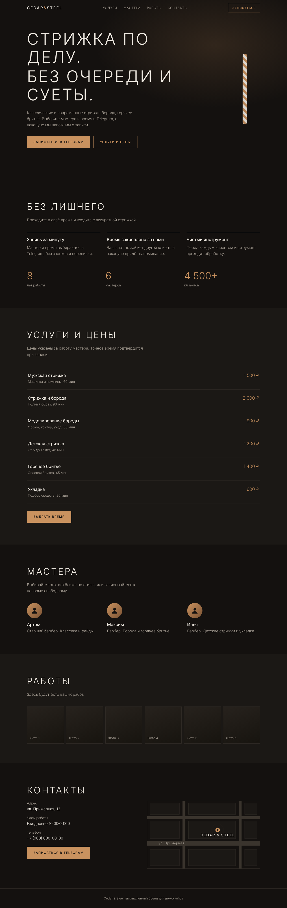

# Cedar & Steel — лендинг барбершопа (демо-кейс)

Адаптивный одностраничный сайт для барбершопа с онлайн-записью через Telegram-бота. Бренд вымышленный, проект сделан как демонстрация работы и легко переиспользуется под реального клиента.

**[Открыть демо](https://terves777.github.io/cedar-steel-demo/)** · без сборщиков, без зависимостей, один набор статических файлов.



## Что внутри

- Hero с построчным появлением заголовка и анимированным барбер-пилоном
- Преимущества, счётчики с анимацией (запускаются один раз при появлении в экране)
- Прайс-лист, карточки мастеров, галерея работ
- Контакты и схематичная карта (инлайн-SVG, без внешних сервисов)
- Кнопки записи в Telegram: в шапке, hero, прайсе, контактах и в нижней панели на телефоне
- Мобильное меню (бургер) с `aria-expanded`, закрытием по `Esc` и по клику на пункт

## Технические детали

| Область | Что сделано |
|---|---|
| Стек | HTML5, CSS3 (переменные, grid, flex), vanilla JS (ES2020, без библиотек) |
| Адаптивность | от 320 px до десктопа, `100svh`, `safe-area-inset` для iPhone |
| Доступность | семантическая разметка, skip-ссылка, `:focus-visible`, `aria-*` у меню, `inert` у скрытой нижней панели, `scroll-padding-top` для якорей, `prefers-reduced-motion` |
| Производительность | один обработчик скролла на кадр (`requestAnimationFrame`), `IntersectionObserver` для счётчиков, шрифт с `display=swap`, ни одного тяжёлого файла |
| SEO и шеринг | `description`, Open Graph и Twitter-теги, `theme-color`, favicon, JSON-LD (`BarberShop`) |
| Без JS | контент и ссылки записи работают, счётчики показывают итоговые значения |

## Структура

```
cedar-steel-demo/
├── index.html
├── css/styles.css
├── js/main.js
├── assets/
│   ├── favicon.svg
│   ├── og.png            # превью ссылки 1200×630
│   └── images/           # сюда класть фото работ
├── screenshot.png
└── README.md
```

## Запуск локально

Сборка не нужна. Откройте `index.html` в браузере или поднимите локальный сервер:

```bash
python -m http.server 8000
# затем откройте http://localhost:8000
```

## Как адаптировать под клиента

| Что поменять | Где |
|---|---|
| Ссылка на бота записи | в `index.html` найти и заменить `https://t.me/bookstitle_bot` (поиск по файлу, Ctrl+H) |
| Название, тексты, цены, мастера | `index.html` |
| Адрес, телефон, часы работы | блок «Контакты» и JSON-LD в `<head>` |
| Цвета и шрифт | переменные в начале `css/styles.css` (`:root`) |
| Карта | заменить блок `.map` на `<iframe>` 2ГИС или Яндекс Карт |
| Фото работ | положить файлы в `assets/images/` и заменить `<figcaption>` в `<figure>` на `` (пример есть в комментарии в `index.html`) |
| Превью для соцсетей | заменить `assets/og.png` (1200×630) и поправить `USERNAME` в `og:image` |

## Публикация на GitHub Pages

1. Создайте репозиторий `cedar-steel-demo` и загрузите в него файлы проекта.
2. В репозитории: **Settings → Pages → Build and deployment → Deploy from a branch**.
3. Выберите ветку `main` и папку `/ (root)`, нажмите **Save**.
4. Через 1–2 минуты сайт будет доступен по адресу `https://terves777.github.io/cedar-steel-demo/`.
5. Подставьте этот адрес в `og:image` в `index.html`, в ссылку демо выше и в описание репозитория.

## Примечания

- Бренд, адрес, телефон и цены вымышлены. Бот `@bookstitle_bot` указан как пример.
- Шрифт [Jost](https://fonts.google.com/specimen/Jost) подключается с Google Fonts (лицензия SIL OFL).
